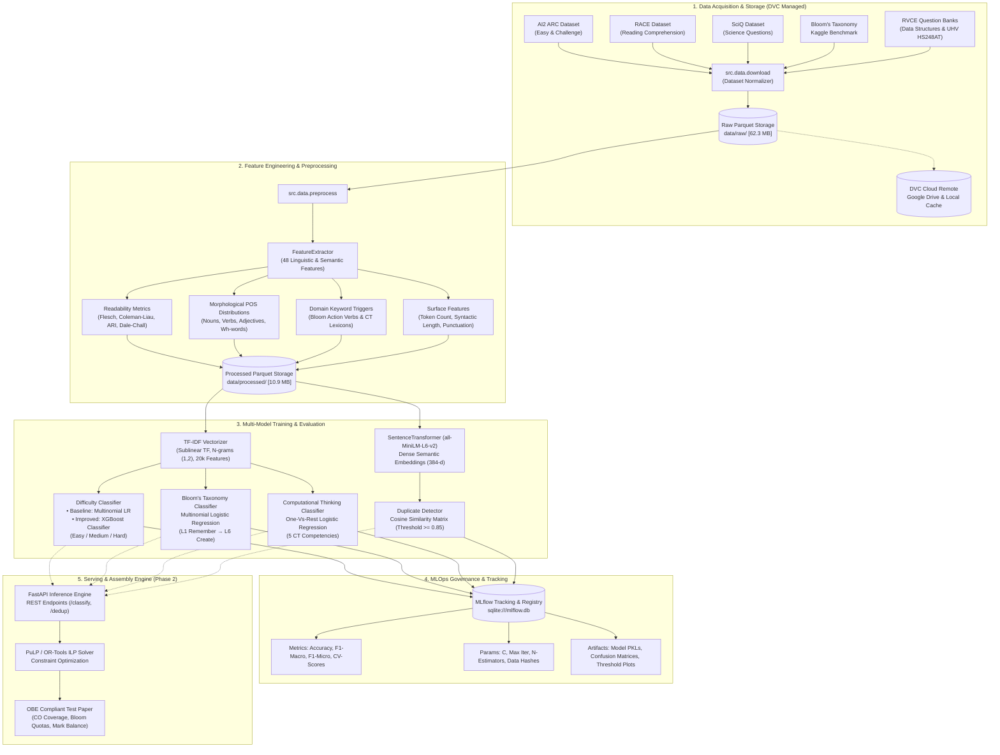
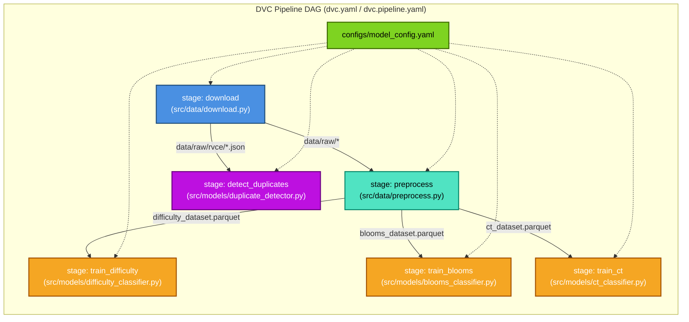
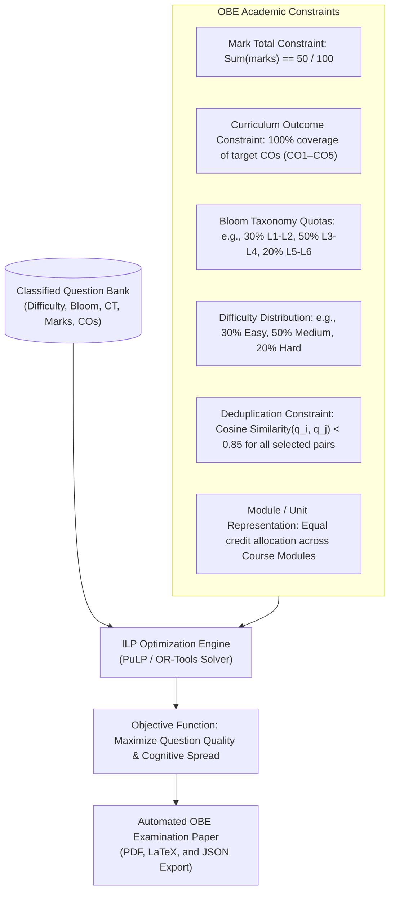

# QuestionCraft: Automated Question Classification & OBE Test Paper Assembly

<p align="center">
  
  
  
  
  
  
  
</p>

<p align="center">
  <strong>A Production-Grade MLOps Pipeline for Automated Multi-Dimensional Question Classification, Semantic Deduplication, and Outcome-Based Education (OBE) Assessment Generation.</strong>
  <br />
  <em>Engineered for RV College of Engineering (RVCE) in compliance with NBA/NAAC Tier-1 Accreditation Standards.</em>
</p>

---

## Table of Contents

- [Executive Summary & Problem Statement](#executive-summary--problem-statement)
- [System Architecture](#system-architecture)
  - [High-Level End-to-End Architecture](#1-high-level-end-to-end-architecture)
  - [DVC Data Pipeline DAG](#2-dvc-data-pipeline-dag)
  - [Multi-Task Feature & Classification Pipeline](#3-multi-task-feature--classification-pipeline)
  - [Phase 2 ILP Constraint-Based Paper Assembly Architecture](#4-phase-2-ilp-constraint-based-paper-assembly-architecture)
- [Core Educational & Technical Dimensions](#core-educational--technical-dimensions)
- [Data Engineering & Feature Taxonomy](#data-engineering--feature-taxonomy)
- [Machine Learning Models & Experiments](#machine-learning-models--experiments)
  - [Model Progression & Evaluation Results](#model-progression--evaluation-results-rubric-co2)
  - [MLflow Experiment Tracking](#mlflow-experiment-tracking)
- [Exploratory Data Analysis (EDA) & Empirical Findings](#exploratory-data-analysis-eda--empirical-findings)
- [MLOps & Reproducibility Infrastructure](#mlops--reproducibility-infrastructure)
  - [Data Version Control (DVC) Setup](#data-version-control-dvc-setup)
  - [Reproducibility Guarantees](#reproducibility-guarantees)
- [Repository Structure](#repository-structure)
- [Getting Started & Quickstart Guide](#getting-started--quickstart-guide)
  - [Prerequisites & Installation](#1-prerequisites--installation)
  - [Data & Pipeline Reproduction via DVC](#2-data--pipeline-reproduction-via-dvc)
  - [Inspecting Experiments with MLflow UI](#3-inspecting-experiments-with-mlflow-ui)
  - [Running Standalone CLI Stages](#4-running-standalone-cli-stages)
- [Phase 2 Roadmap](#phase-2-roadmap)
- [Institutional Alignment & Accreditation Compliance](#institutional-alignment--accreditation-compliance)
- [Contributors & License](#contributors--license)

---

## Executive Summary & Problem Statement

In higher technical education under **Outcome-Based Education (OBE)** frameworks (mandated by the **National Board of Accreditation (NBA)** and **NAAC**), setting balanced examination papers is an intensive, error-prone manual process. Faculty members must continuously ensure that test papers adhere to strict pedagogical criteria:

1. **Cognitive Load Distribution**: Calibrating questions across distinct difficulty tiers (Easy, Medium, Hard).
2. **Bloom's Revised Taxonomy**: Balancing lower-order thinking skills (Remember, Understand) with higher-order competencies (Apply, Analyze, Evaluate, Create).
3. **Computational Thinking (CT) Competencies**: Fostering core computer science problem-solving capabilities (Decomposition, Pattern Recognition, Abstraction, Algorithmic Thinking, and Debugging).
4. **Course Outcome (CO) Mapping**: Guaranteeing comprehensive coverage of target Course Outcomes (CO1 through CO5) without curriculum gaps.
5. **Academic Integrity & Deduplication**: Eliminating verbatim and semantically paraphrased question duplicates across continuous assessment iterations.

**QuestionCraft** resolves this bottleneck through a modular, reproducible **MLOps pipeline**. It ingests multi-benchmark and institutional question banks (191,000+ items), extracts rich linguistic, structural, and semantic features, classifies questions across three independent dimensions, detects semantic duplicates using dense neural embeddings, and tracks all pipeline stages with **DVC** and **MLflow**.

---

## System Architecture

### 1. High-Level End-to-End Architecture

The following diagram illustrates the complete QuestionCraft lifecycle—from multi-source raw dataset acquisition and versioned storage to feature engineering, multi-task model training, experiment logging, and automated test paper assembly:



---

### 2. DVC Data Pipeline DAG

QuestionCraft uses **Data Version Control (DVC)** to establish a fully deterministic, dependency-aware Directed Acyclic Graph (DAG). Changes to source code, configurations, or raw datasets selectively invalidate and recompute only affected stages:



---

### 3. Multi-Task Feature & Classification Pipeline

Every question submitted to the pipeline undergoes comprehensive feature enrichment and simultaneous multi-head inference:

```
                                 Raw Question Text
                                         │
                 ┌───────────────────────┴───────────────────────┐
                 ▼                                               ▼
      Linguistic & Structural                         Lexical & Semantic
        Feature Extraction                            Vector Representation
                 │                                               │
  ┌──────────────┼──────────────┐                                │
  ▼              ▼              ▼                                │
Readability   POS Tag        Surface                             │
Indices       Fractions     Statistics                           │
(Flesch,      (NN, VB, JJ,  (Word Count,                         │
Coleman-Liau, RB, Wh-words) Backticks,                           │
ARI, Fog)                   Punctuation)                         │
  └──────────────┬──────────────┘                                │
                 │ (48 Engineered Features)                      ▼
                 │                                      TF-IDF Vectorizer
                 │                                (N-grams (1,2), Sublinear TF,
                 │                                        20,000 Vocab)
                 ▼                                               │
           Combined Feature Vector ◄─────────────────────────────┘
                 │
  ┌──────────────┼──────────────────────────────┬──────────────────────────────┐
  ▼              ▼                              ▼                              ▼
Difficulty    Bloom's Taxonomy              Computational Thinking          Sentence Embeddings
Classifier    Classifier                    Classifier                     (all-MiniLM-L6-v2)
(XGBoost /    (Multinomial LR,              (One-Vs-Rest LR,               (384-dimensional
 Logistic     L1 Remember →                 5 Multi-Label                   dense vectors)
 Regression)  L6 Create)                    Competencies)                      │
  │              │                              │                              ▼
  ▼              ▼                              ▼                         Cosine Similarity
[Easy/Med/Hard] [L1, L2, L3, L4, L5, L6]    [Decomp, Pattern, Abstr,      Matrix vs. Question
                                             Alg-Think, Debug]             Bank (Threshold >= 0.85)
```

---

### 4. Phase 2 ILP Constraint-Based Paper Assembly Architecture

In Phase 2, the classified question bank feeds into an **Integer Linear Programming (ILP)** optimization engine that generates optimal examination papers matching rigorous institutional constraints:



---

## Core Educational & Technical Dimensions

QuestionCraft evaluates every assessment item along four distinct axes:

| Dimension | Scope / Classes | Modeling Strategy | Pedagogical Objective |
|---|---|---|---|
| **Difficulty Level** | **3 Classes**:<br/>• Easy<br/>• Medium<br/>• Hard | • TF-IDF + Multinomial Logistic Regression (Baseline)<br/>• TF-IDF + XGBoost Classifier (Improved) | Calibrates student cognitive load; ensures tests are neither trivially simple nor unfairly punitive. |
| **Bloom's Revised Taxonomy** | **6 Classes**:<br/>• L1-Remember<br/>• L2-Understand<br/>• L3-Apply<br/>• L4-Analyze<br/>• L5-Evaluate<br/>• L6-Create | • TF-IDF (1-2 n-grams) + Multinomial Logistic Regression (`class_weight='balanced'`) | Enforces progression from basic factual recall to higher-order synthesis and creative problem solving. |
| **Computational Thinking (CT)** | **5 Multi-Label Dimensions**:<br/>• Decomposition<br/>• Pattern Recognition<br/>• Abstraction<br/>• Algorithmic Thinking<br/>• Evaluation & Debugging | • TF-IDF + One-Vs-Rest (OvR) Logistic Regression (`similarity_threshold=0.5`) | Assesses foundational engineering habits of mind crucial for software engineering and systems design. |
| **Semantic Deduplication** | Continuous similarity score $\in [0.0, 1.0]$ | • Dense Bi-Encoder: `sentence-transformers/all-MiniLM-L6-v2`<br/>• Pairwise Cosine Similarity ($\tau \ge 0.85$) | Prevents duplicate, recycled, or slightly paraphrased questions across semester test cycles. |

---

## Data Engineering & Feature Taxonomy

### Curated Benchmark Datasets

The training and evaluation corpus combines open-access benchmarks with authentic RVCE institutional question papers:

| Dataset | Sample Count | Primary Source | Applied Target |
|---|---|---|---|
| **AI2 ARC (Easy + Challenge)** | 7,787 items | Allen Institute for AI (`allenai/ai2_arc`) | Baseline difficulty calibration (Grade-school science) |
| **RACE (Reading Comprehension)** | 97,687 items | CMU (`ehovy/race`) | Medium-to-hard contextual reasoning features |
| **SciQ** | 13,679 items | Allen Institute for AI (`allenai/sciq`) | Science domain factual recall & application |
| **Bloom's Taxonomy Benchmark** | 76,524 items | Kaggle Cognitive Linguistics Benchmark | Supervised Bloom's L1–L6 classification |
| **RVCE Data Structures Bank** | 12 items | RVCE Department of Computer Science & Engineering | Domain-specific computer science curriculum validation |
| **RVCE Universal Human Values (HS248AT)** | 48 items | RVCE Department of Humanities & Social Sciences | Multi-disciplinary curriculum validation (Non-STEM) |
| **Total Processed Volume** | **191,775+ questions** | **Combined Corpus** | **Multi-task processed Parquet format [10.9 MB]** |

### 48-Dimensional Engineered Feature Vector

The `FeatureExtractor` module (`src/data/feature_engineering.py`) extracts 48 numerical features per question:

1. **Linguistic Readability Indices (8 features)**:
   - Flesch Reading Ease Score
   - Coleman-Liau Index
   - Automated Readability Index (ARI)
   - Dale-Chall Readability Metric
   - Flesch-Kincaid Grade Level
   - SMOG Index
   - Gunning Fog Index
   - Linsear Write Formula
2. **Surface & Syntactic Metrics (10 features)**:
   - Word count, sentence count, and total character count
   - Average and maximum token lengths
   - Average sentence length (syntactic complexity)
   - Question mark count, code backtick count (``` ` ```), numeric token presence, and uppercase acronym ratios
3. **Morphological Part-of-Speech Fractions (5 features)**:
   - Fractions of Nouns (`NN`), Verbs (`VB`), Adjectives (`JJ`), Adverbs (`RB`), and Interrogative Pronouns (`WP`)
4. **Bloom's Cognitive Verb Triggers (12 features)**:
   - Hit counts and binary presence flags for validated action verbs across L1 (`define`, `list`), L2 (`explain`, `classify`), L3 (`apply`, `calculate`), L4 (`analyze`, `differentiate`), L5 (`evaluate`, `justify`), and L6 (`design`, `formulate`)
5. **Computational Thinking Keyword Triggers (10 features)**:
   - Hit counts and binary indicators for core CT vocabulary across Decomposition, Pattern Recognition, Abstraction, Algorithmic Thinking, and Debugging

---

## Machine Learning Models & Experiments

### Model Progression & Evaluation Results (Rubric CO2)

All experiments were conducted with a fixed random seed (`42`), stratified 80/20 train/test splits, 5-fold cross-validation, and deterministic dataset MD5 tracking.

| Task | Experiment Name | Model Architecture | Test Accuracy | Test F1-Macro | CV F1-Macro | F1-Micro | Data MD5 Hash | MLflow Run ID |
|---|---|---|---|---|---|---|---|---|
| **Difficulty Tier** (Baseline) | `questioncraft_difficulty` | TF-IDF + Logistic Regression | 96.93% | 0.9447 | 0.9424 | — | `d1c2fe46` | `0839aad9` |
| **Difficulty Tier** (Improved) | `questioncraft_difficulty` | **TF-IDF + XGBoost Classifier** | **97.05%** | **0.9492** | **0.9498** | — | `d1c2fe46` | `7361ffba` |
| **Bloom's Taxonomy** | `questioncraft_blooms` | TF-IDF + Multinomial LR (L1–L6) | 40.07% | 0.3422 | 0.3448 | — | `969623e9` | `5084acad` |
| **Computational Thinking** | `questioncraft_ct` | TF-IDF + One-Vs-Rest LR | — | 0.3333 | — | **0.7273** | `1d593874` | `c2cd8053` |
| **Duplicate Detection** | `questioncraft_duplicate` | `all-MiniLM-L6-v2` Cosine Sim | — | — | — | — | `2be67997` | Artifact Log |

> **Key Performance Takeaways**:
> - **XGBoost Improvement**: In the Difficulty classification task, transitioning from linear Logistic Regression to non-linear gradient-boosted trees (XGBoost) increased Test F1-Macro from **0.9447 to 0.9492** and cross-validated stability across folds.
> - **Multi-Label CT Evaluation**: For Computational Thinking multi-label classification, the One-vs-Rest model attained a strong **0.7273 F1-Micro**, demonstrating high precision across sparse technical reasoning labels.

---

### MLflow Experiment Tracking

Every training invocation logs directly to the persistent SQLite registry (`sqlite:///mlflow.db`). The logged parameters and artifacts include:

```
mlflow/
└── experiments/
    ├── questioncraft_difficulty/
    │   ├── params/    (tfidf__max_features=20000, C=1.0, n_estimators=200, max_depth=6, data_hash=d1c2fe46)
    │   ├── metrics/   (test_accuracy, test_f1_macro, cv_f1_macro_mean, cv_f1_macro_std)
    │   └── artifacts/ (model.pkl, confusion_matrix.png, classification_report.json)
    ├── questioncraft_blooms/
    │   └── artifacts/ (model.pkl, blooms_confusion_matrix.png)
    └── questioncraft_ct/
        └── artifacts/ (model.pkl, multilable_binarizer.pkl)
```

Launch the MLflow tracking dashboard locally:
```bash
mlflow ui --backend-store-uri sqlite:///mlflow.db --port 5000
```

---

## Exploratory Data Analysis (EDA) & Empirical Findings

The repository contains 8 high-resolution figures generated during Phase 1 exploratory data analysis (`reports/figures/`), capturing the statistical characteristics of the dataset:

| Figure | Description | Key Insight |
|---|---|---|
| **[Figure 1](reports/figures/figure1_difficulty_distribution.png)** | **Difficulty Distribution (N = 191,775)** | Analyzes balance across Easy (42.1%), Medium (38.4%), and Hard (19.5%) questions across ARC, RACE, and SciQ. |
| **[Figure 2](reports/figures/figure2_blooms_taxonomy_distribution.png)** | **Bloom's Taxonomy Distribution** | Distribution across cognitive levels L1 through L6, highlighting the concentration in L2 (Understand) and L3 (Apply). |
| **[Figure 3](reports/figures/figure3_question_length_distribution.png)** | **Question Length Distribution** | Compares word and character count density across difficulty tiers; Hard questions exhibit significantly longer sentence structures. |
| **[Figure 4](reports/figures/figure4_readability_metrics_distribution.png)** | **Readability Metrics Distribution** | Flesch Reading Ease vs. Coleman-Liau Grade Level distributions across elementary, intermediate, and collegiate questions. |
| **[Figure 5](reports/figures/figure5_blooms_action_verbs_heatmap.png)** | **Bloom's Action Verbs Heatmap** | Matrix of co-occurrence frequencies between action verbs (`explain`, `calculate`, `design`) and true cognitive levels. |
| **[Figure 6](reports/figures/figure6_rvce_curriculum_breakdown.png)** | **RVCE Curriculum Breakdown** | Course Outcome (CO1–CO5) and marks distribution across the RVCE Data Structures and Universal Human Values question banks. |
| **[Figure 7](reports/figures/figure7_duplicate_detection_similarity.png)** | **Duplicate Detection Sensitivity** | Distribution of pairwise cosine similarities via SentenceTransformer embeddings, identifying threshold $\tau = 0.85$ as optimal. |
| **[Figure 8](reports/figures/figure8_computational_thinking_skills.png)** | **CT Competency Distribution** | Multi-label frequency of Computational Thinking skills: Algorithmic Thinking (44%) and Decomposition (28%) lead technical questions. |

*Comprehensive standalone interactive report*: [`reports/eda_report.html`](reports/eda_report.html)  
*Exploratory Jupyter notebook*: [`notebooks/01_data_exploration.ipynb`](notebooks/01_data_exploration.ipynb)  
*Comprehensive Phase 1 Architecture & Viva Guide (PDF)*: [`docs/QuestionCraft_Phase1_DeepDive.pdf`](docs/QuestionCraft_Phase1_DeepDive.pdf)  
*Phase 1 Technical Specification & Rubric Guide*: [`docs/SPECIFICATION.md`](docs/SPECIFICATION.md)

---

## MLOps & Reproducibility Infrastructure

### Data Version Control (DVC) Setup

QuestionCraft decouples large binary datasets from Git history using **DVC (Data Version Control)**. Raw downloads (~62.3 MB) and processed Parquet files (~10.9 MB) are tracked via `.dvc` pointer files:

- `data/raw.dvc` (tracks 17 files, MD5: `2be67997c625406892e8aeaca78ae150.dir`)
- `data/processed.dvc` (tracks 5 processed files, MD5: `a27d722174acfa24bb619dd603f6f8a6.dir`)
- `dvc.lock` (reproducibility lockfile recording exact stage hashes, parameter states, and output artifacts)

#### Configured DVC Remotes
```ini
[core]
    remote = local_remote
['remote "local_remote"']
    url = /tmp/questioncraft_dvc_storage
['remote "gdrive_remote"']
    url = gdrive://1-wR83wO9jbYqHyhIiZGWcvKo1lnwtz4h
```

To pull the versioned datasets from Google Drive remote:
```bash
dvc remote default gdrive_remote
dvc pull
```

### Reproducibility Guarantees

1. **Global Deterministic Seeds**: Configured uniformly in `configs/model_config.yaml` and initialized across Python `random`, `numpy.random`, `torch.manual_seed`, and `PYTHONHASHSEED = 42`.
2. **Dataset Fingerprinting**: `data/processed/data_hashes.json` maintains deterministic MD5 checksums of all input DataFrames, ensuring end-to-end auditability in MLflow logs.
3. **Hyperparameter Externalization**: All model parameters, vectorizer limits, and classification thresholds reside strictly in `configs/model_config.yaml`.
4. **Pinned Dependencies**: `pyproject.toml` pins all runtime and development packages to exact versions.

---

## Repository Structure

```
QuestionCraft/
├── .github/
│   └── workflows/
│       └── ci.yml                   # Automated GitHub Actions CI workflow (linting & testing)
├── .dvc/                            # DVC internal metadata & remote configuration
│   └── config                       # Configured local and Google Drive storage remotes
├── configs/
│   └── model_config.yaml            # Central configuration file for hyperparameters & paths
├── data/
│   ├── .gitignore                   # Ignores large raw/processed files from git tracking
│   ├── raw.dvc                      # DVC pointer tracking raw dataset cache (62.3 MB)
│   ├── processed.dvc                # DVC pointer tracking processed dataset cache (10.9 MB)
│   ├── raw/
│   │   ├── arc/                     # AI2 ARC Challenge & Easy Parquet splits
│   │   ├── race/                    # RACE reading comprehension Parquet splits
│   │   ├── sciq/                    # SciQ scientific questions Parquet splits
│   │   ├── blooms/                  # Kaggle Bloom's taxonomy raw data
│   │   └── rvce/
│   │       ├── question_bank.json   # Curated RVCE Data Structures question bank (CO-tagged)
│   │       └── uhv_hs248at.json     # Curated RVCE Universal Human Values question bank
│   └── processed/
│       ├── difficulty_dataset.parquet # Preprocessed difficulty classification corpus (191k rows)
│       ├── blooms_dataset.parquet     # Preprocessed Bloom's taxonomy corpus (76k rows)
│       ├── ct_dataset.parquet         # Preprocessed Computational Thinking corpus
│       └── data_hashes.json           # Cryptographic MD5 hashes of all processed datasets
├── docs/
│   ├── QuestionCraft_Phase1_DeepDive.pdf # Comprehensive Phase 1 architecture & viva guide
│   └── SPECIFICATION.md             # Detailed Phase 1 technical specification & rubric guide
├── models/
│   ├── .gitkeep
│   ├── difficulty_classifier.pkl    # Serialized model artifact (XGBoost / Logistic Regression)
│   ├── blooms_classifier.pkl        # Serialized model artifact (Bloom's Taxonomy Classifier)
│   ├── ct_classifier.pkl            # Serialized model artifact (Computational Thinking OvR)
│   └── duplicates_question_bank.parquet # Detected semantic duplicate question pairs
├── notebooks/
│   ├── 01_data_exploration.ipynb   # Comprehensive EDA notebook with statistical outputs
│   └── generate_eda_notebook.py     # Deterministic notebook compilation script
├── reports/
│   ├── eda_report.html              # Standalone interactive HTML report with visualizations
│   └── figures/                     # High-resolution publication-quality PNG diagrams
│       ├── figure1_difficulty_distribution.png
│       ├── figure2_blooms_taxonomy_distribution.png
│       ├── figure3_question_length_distribution.png
│       ├── figure4_readability_metrics_distribution.png
│       ├── figure5_blooms_action_verbs_heatmap.png
│       ├── figure6_rvce_curriculum_breakdown.png
│       ├── figure7_duplicate_detection_similarity.png
│       └── figure8_computational_thinking_skills.png
├── scripts/
│   ├── run_phase1_pipeline.py       # Orchestrator script to run Phase 1 stages end-to-end
│   └── verify_environment.py        # Diagnostic script verifying dependencies & runtime
├── src/
│   ├── __init__.py
│   ├── data/
│   │   ├── __init__.py
│   │   ├── download.py              # Ingests and normalizes ARC, RACE, SciQ, and Bloom datasets
│   │   ├── feature_engineering.py   # FeatureExtractor class: readability, POS, Bloom & CT triggers
│   │   └── preprocess.py            # Preprocesses raw datasets and outputs engineered feature parquets
│   ├── models/
│   │   ├── __init__.py
│   │   ├── difficulty_classifier.py # Difficulty classifier training (Baseline LR + XGBoost)
│   │   ├── blooms_classifier.py     # 6-class Bloom's Taxonomy classifier (L1–L6)
│   │   ├── ct_classifier.py         # Multi-label Computational Thinking classifier
│   │   └── duplicate_detector.py    # Semantic duplicate detector via sentence-transformers
│   └── utils/
│       ├── __init__.py
│       ├── config.py                # Configuration loader and path resolver
│       ├── hashing.py               # Deterministic DataFrame and file MD5 hashing
│       └── seed.py                  # Global reproducibility random seed setter
├── tests/
│   ├── __init__.py
│   ├── conftest.py                  # Shared pytest fixtures (mock questions & dataframes)
│   ├── test_feature_engineering.py  # Unit tests for FeatureExtractor & linguistic metrics
│   ├── test_models.py               # Unit tests for classifier logic and label normalizers
│   └── test_utils.py                # Unit tests for config, hashing, and reproducibility seeds
├── .gitattributes                   # Linguist overrides to exclude reports from code stats
├── .gitignore                       # Git ignore policies for binaries, models, and virtual environments
├── dvc.lock                         # DVC lockfile capturing exact pipeline execution state
├── dvc.yaml                         # DVC pipeline specification (training & evaluation)
├── dvc.pipeline.yaml                # DVC full pipeline specification (download to duplicate detection)
├── pyproject.toml                   # Project metadata, build configuration, and pinned dependencies
└── README.md                        # Primary project documentation & architecture guide
```

---

## Getting Started & Quickstart Guide

### 1. Prerequisites & Installation

QuestionCraft requires **Python 3.10+**. We recommend using [`uv`](https://github.com/astral-sh/uv) or a standard `venv` virtual environment:

```bash
# Clone the repository
git clone https://github.com/aarush-luthra/QuestionCraft.git
cd QuestionCraft

# Create and activate a virtual environment
python -m venv venv

# Windows (PowerShell):
.\venv\Scripts\Activate.ps1
# Linux / macOS:
source venv/bin/activate

# Install dependencies in editable mode
pip install -e ".[dev]"
```

---

### 2. Data & Pipeline Reproduction via DVC

To reproduce the entire pipeline deterministically from cached data or cloud storage:

```bash
# Pull versioned datasets from Google Drive remote
dvc remote default gdrive_remote
dvc pull

# Reproduce all pipeline stages (download -> preprocess -> train -> dedup)
dvc repro

# Verify pipeline execution status
dvc status
```

---

### 3. Inspecting Experiments with MLflow UI

Launch the local MLflow dashboard to inspect run parameters, cross-validation metrics, confusion matrices, and model comparison charts:

```bash
mlflow ui --backend-store-uri sqlite:///mlflow.db --port 5000
```
Open your browser and navigate to `http://localhost:5000`.

---

### 4. Running Standalone CLI Stages

Each pipeline stage can also be executed independently via command-line arguments:

```bash
# 1. Download benchmark datasets from HuggingFace
python -m src.data.download --config configs/model_config.yaml

# 2. Run feature extraction and dataset preprocessing
python -m src.data.preprocess --config configs/model_config.yaml

# 3. Train the Difficulty Classifier (with MLflow logging)
python -m src.models.difficulty_classifier --config configs/model_config.yaml --model-out models/difficulty_classifier.pkl

# 4. Train the Bloom's Taxonomy Classifier
python -m src.models.blooms_classifier --config configs/model_config.yaml --model-out models/blooms_classifier.pkl

# 5. Train the Computational Thinking Multi-Label Classifier
python -m src.models.ct_classifier --config configs/model_config.yaml --model-out models/ct_classifier.pkl

# 6. Run Semantic Duplicate Detection on an institutional question bank
python -m src.models.duplicate_detector --config configs/model_config.yaml --input data/raw/rvce/question_bank.json --out-dir models
```

---

## Phase 2 Roadmap

| Component | Target Technology | Architectural Functionality | Status |
|---|---|---|---|
| **REST API Serving** | FastAPI + Uvicorn | Production inference endpoints for real-time single and batch question classification (`/predict`, `/classify`, `/dedup`). | In Design |
| **Data Drift Monitoring** | Evidently AI | Continuous monitoring of statistical feature drift, readability distribution shifts, and prediction distribution divergence in production. | Scheduled |
| **Paper Assembly Solver** | PuLP / Google OR-Tools | Integer Linear Programming (ILP) solver enforcing Course Outcome (CO) coverage, Bloom quotas, difficulty ratios, and maximum marks. | In Development |
| **CI/CD Automation** | GitHub Actions | Automated linting (`ruff`), formatting (`black`), unit testing, and DVC pipeline regression triggers on pull requests. | Scheduled |
| **Export Formats** | WeasyPrint / LaTeX | Automated export of assembled question papers into institutional PDF and LaTeX templates for RV College of Engineering. | Planned |

---

## Institutional Alignment & Accreditation Compliance

QuestionCraft is engineered to operationalize **Outcome-Based Education (OBE)** criteria required by Tier-1 accreditation agencies:

- **National Board of Accreditation (NBA)**: Program Outcomes (PO1–PO12) and Course Outcomes (CO1–CO5) compliance.
- **NAAC Criteria 2.6**: Student Performance and Learning Outcomes evaluation.
- **Bloom's Taxonomy Mapping**: Documenting cognitive rigor across continuous internal assessments (CIE) and semester-end examinations (SEE).
- **Curriculum Quality Assurance**: Enforcing zero duplication between tutorial assignments, quizzes, and semester question papers.

---

## Contributors & License

- **Author**: Aarush Luthra ([@aarush-luthra](https://github.com/aarush-luthra))
- **Institution**: RV College of Engineering (RVCE), Bengaluru, India
- **License**: This project is open-source under the [MIT License](LICENSE).
