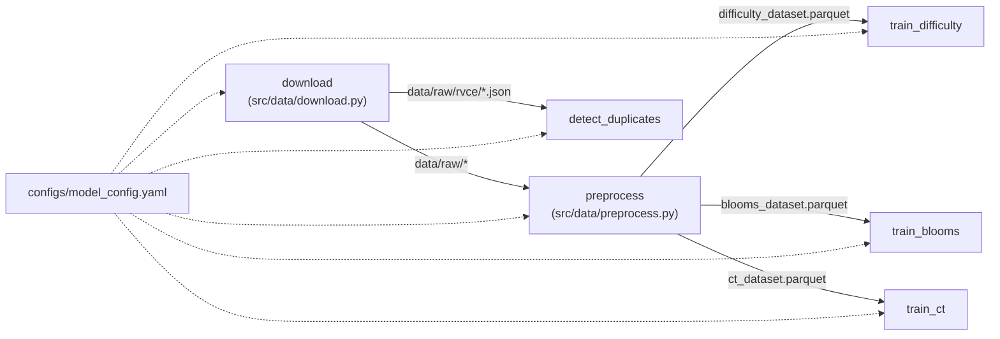

# QuestionCraft

<p align="center">
  
  
  
  
  
  
</p>

Automated question classification and OBE-compliant test paper assembly, built as an MLOps project for the AI254TA course at RVCE.

The system takes a question bank as input, classifies each question along three dimensions (difficulty, Bloom's level, and computational thinking skill), flags semantic duplicates, and exposes everything through a REST API. Phase 2 adds a proper deployment pipeline — model registry, quality gates, blue-green promotion, canary routing, and a Docker Compose stack for local evaluation.

---

## Table of Contents

- [What problem this solves](#what-problem-this-solves)
- [How it works](#how-it-works)
  - [Data pipeline (DVC)](#data-pipeline-dvc)
  - [Feature extraction](#feature-extraction)
  - [Models](#models)
- [Results](#results)
- [EDA figures](#eda-figures)
- [Phase 2 — serving and deployment](#phase-2--serving-and-deployment)
  - [API endpoints](#api-endpoints)
  - [Deployment strategies](#deployment-strategies)
  - [Running the demo](#running-the-demo)
- [Repository layout](#repository-layout)
- [Getting started](#getting-started)
- [Accreditation context](#accreditation-context)
- [License](#license)

---

## What problem this solves

Setting exam papers in an OBE curriculum is surprisingly time-consuming. For every test, faculty need to make sure questions cover the right course outcomes, hit a sensible spread of Bloom's levels, don't recycle questions from previous papers, and add up to the right mark totals. Doing all of that manually for every CIE and SEE is tedious and inconsistent.

This project automates the classification step — given a question, it tells you the difficulty tier, the Bloom's level, and which computational thinking skills it exercises — and checks whether the question is too similar to something already in the bank. The Phase 2 API wraps this into a service you can call from whatever paper-generation tool you're building.

---

## How it works

### Data pipeline (DVC)

Raw data lives in `data/raw/` (tracked by DVC, not committed to git). The pipeline downloads public benchmarks and merges them with the RVCE question banks:

| Dataset | Size | Purpose |
|---|---|---|
| AI2 ARC (Easy + Challenge) | 7,787 questions | Difficulty calibration |
| RACE | 97,687 questions | Medium/hard reading comprehension |
| SciQ | 13,679 questions | Science factual recall |
| Bloom's Taxonomy Benchmark | 76,524 questions | L1–L6 supervised labels |
| RVCE Data Structures bank | 12 questions | Domain validation |
| RVCE UHV HS248AT | 48 questions | Non-STEM validation |

The preprocessed corpus ends up at ~191k questions in Parquet format under `data/processed/`. The DVC pipeline DAG looks like this:



To pull the data and reproduce the pipeline:
```bash
dvc remote default gdrive_remote
dvc pull
dvc repro
```

### Feature extraction

`src/data/feature_engineering.py` extracts 48 numerical features per question before passing anything to the classifiers:

- **Readability scores** (8): Flesch, Coleman-Liau, ARI, Dale-Chall, Flesch-Kincaid, SMOG, Gunning Fog, Linsear Write
- **Surface/syntactic stats** (10): word count, sentence count, character count, avg/max token length, punctuation counts, backtick presence, numeric token ratios
- **POS fractions** (5): nouns, verbs, adjectives, adverbs, interrogative pronouns
- **Bloom's action verb hits** (12): count and binary flags for action verbs at each of the six cognitive levels
- **CT keyword hits** (10): indicators for decomposition, pattern recognition, abstraction, algorithmic thinking, debugging vocabulary

These are concatenated with a TF-IDF vector (unigram + bigram, 20k features, sublinear TF) to form the final input to each classifier.

### Models

Three separate classifiers, each trained independently:

| Task | Architecture | Notes |
|---|---|---|
| **Difficulty** (Easy / Medium / Hard) | TF-IDF + XGBoost (improved over baseline LR) | |
| **Bloom's level** (L1–L6) | TF-IDF + Multinomial Logistic Regression | `class_weight='balanced'` to handle L5/L6 sparsity |
| **Computational Thinking** (5 skills, multi-label) | TF-IDF + One-vs-Rest Logistic Regression | |
| **Duplicate detection** | `all-MiniLM-L6-v2` cosine similarity | Threshold ≥ 0.85 flags likely duplicates |

---

## Results

All runs use seed 42, stratified 80/20 splits, and 5-fold CV. Numbers are logged to MLflow automatically.

| Task | Model | Test Accuracy | F1-Macro | CV F1-Macro |
|---|---|---|---|---|
| Difficulty (baseline) | TF-IDF + Logistic Regression | 96.93% | 0.9447 | 0.9424 |
| Difficulty (improved) | **TF-IDF + XGBoost** | **97.05%** | **0.9492** | **0.9498** |
| Bloom's Taxonomy | TF-IDF + Multinomial LR | 40.07% | 0.3422 | 0.3448 |
| CT Skills | TF-IDF + OvR LR | — | 0.3333 | — (F1-Micro: 0.7273) |

Bloom's accuracy is naturally lower — 6-class classification on a noisy proxy label set where the boundary between e.g. L3-Apply and L4-Analyze is genuinely ambiguous even for humans.

To view the full experiment history:
```bash
mlflow ui --backend-store-uri sqlite:///mlflow.db --port 5000
```

---

## EDA figures

Eight figures are saved to `reports/figures/` from the Phase 1 EDA. A few highlights:

- **Figure 1** — Difficulty distribution across the full corpus (Easy 42%, Medium 38%, Hard 20%)
- **Figure 5** — Bloom's action verb heatmap showing how well lexical triggers actually correlate with ground-truth levels
- **Figure 7** — Cosine similarity distribution for the RVCE question bank, confirming τ = 0.85 as a sensible duplicate threshold
- **Figure 8** — CT skill frequency: Algorithmic Thinking (44%) and Decomposition (28%) dominate

Full interactive report: [`reports/eda_report.html`](reports/eda_report.html)  
Notebook: [`notebooks/01_data_exploration.ipynb`](notebooks/01_data_exploration.ipynb)

---

## Phase 2 — serving and deployment

Phase 2 wraps the trained models into a production service. The deployment target is **Docker Compose** (Kubernetes is out of scope for this project).

| Component | What was built |
|---|---|
| **Data validation** | Rule-based suite in `src/monitoring/model_tests.py` — column checks, null ratios, label set, length, row counts, deduplication. No Great Expectations dependency. |
| **Quality gates** | `src/monitoring/quality_gates.py` — 6 gates: accuracy ≥ 0.85, F1-macro ≥ 0.30, ≤ 2% regression vs Production, CV std ≤ 0.05, data hash match, ≥ 100 test samples. Promotion is blocked if any gate fails. |
| **Model registry** | MLflow Model Registry (`sqlite:///mlflow.db`) — `None → Staging → Production → Archived`. Versions tagged with data hash and metrics. |
| **Inference API** | FastAPI + Uvicorn on port 8000. |
| **Deployment strategies** | Blue-green promotion + canary traffic splitting. |
| **Observability** | Prometheus scrape endpoint (`/metrics`), Grafana dashboard provisioned via Compose. |
| **Containerisation** | Multi-stage Dockerfile, Docker Compose for the full stack. |
| **CI/CD** | GitHub Actions — Ruff + Black, pytest on Python 3.10/3.11, Phase 2 pipeline, Docker build + `/health` smoke test. |

### API endpoints

```
GET  /health              system status, uptime, loaded model count
GET  /artifacts           11 ML artifact manifest (accreditation)
GET  /models/info         active versions, canary ratio, registry stages
GET  /deploy/status       active deployment strategy
POST /predict             classify a single question (difficulty + bloom + CT)
POST /classify            alias for /predict
POST /batch/classify      batch inference
POST /dedup               pairwise duplicate check
POST /batch/dedup         all-pairs deduplication against a question set
POST /deploy/canary       set canary traffic ratio (0.0–1.0)
POST /models/reload       hot-reload models from registry (after promotion)
GET  /metrics             Prometheus text format metrics
```

Interactive docs at `http://localhost:8000/docs` when the server is running.

### Deployment strategies

**Blue-green**: the Production model (blue) handles all traffic while a candidate sits in Staging (green). `scripts/promote_model.py` runs quality gates, archives the old Production version, and promotes the candidate. `POST /models/reload` picks up the change without restarting the container. `--rollback` reverts to the previous Production version.

**Canary**: `POST /deploy/canary?ratio=0.1` sends 10% of incoming requests to the Staging model. `GET /deploy/status` shows the current split and which registry stages each model is at.

### Running the demo

```bash
# Full pipeline check — quality gates, data validation, 11-artifact audit
python scripts/run_phase2_pipeline.py --skip-server --strict

# Evaluator walkthrough (validation → gates → live inference → canary → promote → rollback)
python scripts/demo_for_evaluator.py

# Registry CLI
python scripts/promote_model.py --list
python scripts/promote_model.py --model difficulty --to production   # runs gates
python scripts/promote_model.py --model difficulty --rollback
python scripts/promote_model.py --sync-tags

# Start the full stack (API :8000, MLflow :5000, Prometheus :9090, Grafana :3000)
docker compose up -d

# If port 5000 is taken (macOS AirPlay):
MLFLOW_HOST_PORT=5001 GRAFANA_HOST_PORT=3001 docker compose up -d

# After promoting via CLI while Compose is running, point at the MLflow server:
MLFLOW_TRACKING_URI=http://localhost:5001 python scripts/promote_model.py --model difficulty --to production
curl -X POST localhost:8000/models/reload
```

---

## Repository layout

```
QuestionCraft/
├── .github/workflows/ci.yml        GitHub Actions CI
├── .dvc/                           DVC config and cache metadata
├── configs/
│   ├── model_config.yaml           hyperparameters, paths, seeds
│   └── serving_config.yaml         API and canary settings
├── data/                           gitignored; tracked by DVC
│   ├── raw.dvc
│   └── processed.dvc
├── docs/
│   └── SPECIFICATION.md
├── models/                         serialised .pkl files (gitignored)
├── monitoring/
│   ├── prometheus.yml
│   └── grafana/                    provisioned dashboard and datasource
├── notebooks/
│   └── 01_data_exploration.ipynb
├── reports/
│   ├── eda_report.html
│   └── figures/                    8 PNG figures from EDA
├── scripts/
│   ├── run_phase1_pipeline.py
│   ├── run_phase2_pipeline.py
│   ├── promote_model.py
│   ├── demo_for_evaluator.py
│   ├── seed_demo_artifacts.py
│   └── verify_environment.py
├── src/
│   ├── data/
│   │   ├── download.py             dataset ingestion
│   │   ├── preprocess.py           cleaning and feature parquet output
│   │   ├── feature_engineering.py  48-feature extractor
│   │   └── build_splits.py         RVCE held-out test split builder
│   ├── models/
│   │   ├── difficulty_classifier.py
│   │   ├── blooms_classifier.py
│   │   ├── ct_classifier.py
│   │   └── duplicate_detector.py
│   ├── monitoring/
│   │   ├── model_tests.py          data validation rules
│   │   └── quality_gates.py        pre-promotion gates
│   ├── registry/
│   │   ├── model_manager.py        MLflow registry lifecycle
│   │   └── artifacts.py            11-artifact manifest
│   ├── serving/
│   │   ├── app.py                  FastAPI application
│   │   ├── model_loader.py         ModelStore, canary routing
│   │   └── schemas.py              Pydantic request/response models
│   └── utils/
│       ├── config.py
│       ├── hashing.py              deterministic MD5 fingerprinting
│       └── seed.py
├── tests/
│   ├── conftest.py
│   ├── test_feature_engineering.py
│   ├── test_model_quality.py       quality gates + data validation tests
│   ├── test_models.py
│   ├── test_serving.py             FastAPI endpoint tests
│   └── test_utils.py
├── Dockerfile
├── docker-compose.yml
├── dvc.yaml / dvc.lock / dvc.pipeline.yaml
└── pyproject.toml
```

---

## Getting started

**Requirements**: Python 3.10+. Everything else is in `pyproject.toml`.

```bash
git clone https://github.com/aarush-luthra/QuestionCraft.git
cd QuestionCraft

python -m venv venv
# Windows:
.\venv\Scripts\Activate.ps1
# Linux/macOS:
source venv/bin/activate

pip install -e ".[dev]"
```

Pull the data and reproduce the Phase 1 pipeline:
```bash
dvc remote default gdrive_remote
dvc pull
dvc repro
```

Run the test suite:
```bash
pytest tests/ -v
```

Start the API server locally (without Docker):
```bash
python -m uvicorn src.serving.app:app --host 0.0.0.0 --port 8000
```

---

## Accreditation context

This project is part of the RVCE AI254TA MLOps course (5th semester, AIML). The classification dimensions and CO-mapping features are specifically designed to support NBA Tier-1 and NAAC Criterion 2.6 requirements — both of which ask for documented evidence that assessments cover Course Outcomes at appropriate cognitive levels.

The 11 ML artifact categories tracked by `GET /artifacts` correspond directly to the standard artifact taxonomy in the course evaluation rubric.

---

## License

MIT — see [LICENSE](LICENSE).  
Author: [Aarush Luthra](https://github.com/aarush-luthra), RVCE Bengaluru
